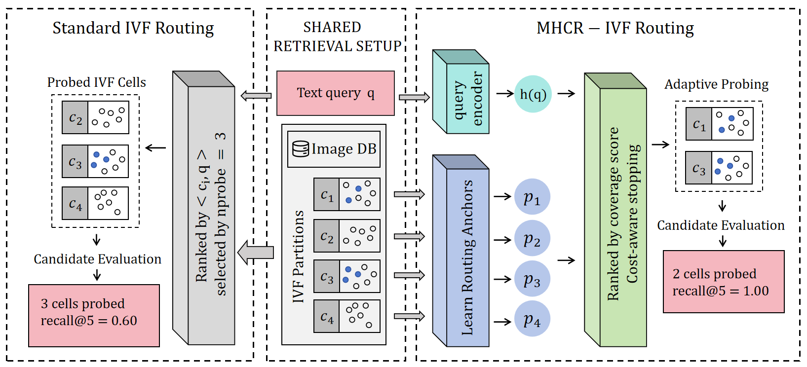

# MHCR: Modal-Heterogeneity-Aware Coverage Routing for Cross-Modal IVF Retrieval

**Learn where the neighbors are. Probe only what matters.**

MHCR is a query-side routing method for cross-modal retrieval over IVF indexes. It learns cell coverage and adapts the probe budget to each query, retaining the existing index and candidate-processing pipeline.

[Quick start](#quick-start) · [Dataset configurations](#dataset-configurations) · [Training & evaluation](repro/README.md) · [QPS benchmark](docs/qps.md)

## Abstract

Efficiently achieving high recall on large image collections remains a key challenge in cross-modal approximate nearest neighbor (ANN) search. Despite substantial progress, cross-modal graph indexes still incur considerable query costs at high recall and large scale. Inverted file (IVF) indexes offer efficient candidate processing through batched scanning and computation over compressed vectors. However, routing mismatch caused by the modality gap introduces additional probing and scanning costs that limit these advantages, while research specifically targeting cross-modal IVF remains limited.

We propose **MHCR** (Modal-Heterogeneity-aware Coverage Routing) to alleviate this routing mismatch and realize IVF's potential for efficient candidate processing on large cross-modal image collections. MHCR is a drop-in query-side method that learns per-cell coverage utility from offline nearest-neighbor supervision and adaptively allocates the probe budget per query, while leaving the IVF partition, inverted lists, and reranking stage unchanged. Across three typical benchmarks at scales ranging from 10M to 128M, MHCR achieves up to **1.95×** speedup over IVF-based indexes and **153.1×** over cross-modal graph indexes at the same recall level.

## Overview



**MHCR replaces centroid-based routing with learned coverage scores and cost-aware probe selection.** The illustration shows five target neighbors; benchmarks use **Recall@100**.

## Quick start

Requires **Linux**, **Python 3.10+**, and a CPU build of Faiss. PyTorch, NumPy, Faiss and PyYAML are installed with the package.

```bash
git clone https://github.com/Alpaca099/MHCR.git
cd MHCR
pip install -e .
```

Build and train from your vectors:

```bash
mhcr-pipeline --config repro/configs/cc3m.yaml --inputs inputs.yaml --out artifacts/cc3m --threads 8
```

See [training and evaluation](repro/README.md) for input formats, model training and operating-point calibration.

| Task | Entry point |
|---|---|
| Run the complete pipeline from vectors | `mhcr-pipeline` |
| Build an IVF-PQ FastScan index | `mhcr-build` |
| Train the teacher or student | `mhcr-train --stage teacher` / `--stage student` |
| Measure Recall@100 and latency | `mhcr-evaluate` |
| Measure latency breakdown | `mhcr-evaluate --breakdown` |
| Run routing ablations | `mhcr-evaluate --ablation` |
| Measure throughput | `mhcr-qps` |

Use `--help` with any command for its options. The same commands are available as Python scripts in [`repro/`](repro/).

## Dataset configurations

| Dataset | Gallery size | Dimensions | IVF cells | Configuration |
|---|---:|---:|---:|---|
| CC3M | 2,885,954 | 512 | 8,192 | [cc3m.yaml](repro/configs/cc3m.yaml) |
| CC12M | 10,948,533 | 512 | 16,384 | [cc12m.yaml](repro/configs/cc12m.yaml) |
| YFCC | 14,825,237 | 768 | 16,384 | [yfcc15m.yaml](repro/configs/yfcc15m.yaml) |
| DataComp | 128,000,000 | 768 | 65,536 | [datacomp128m.yaml](repro/configs/datacomp128m.yaml) |

Dataset settings and calibration requirements are documented in [`repro/configs/`](repro/configs/README.md).
DataComp reads its full gallery through the [FP16 shard backend](docs/fp16-gallery.md).

## License

MHCR is released under the [Apache License 2.0](LICENSE).
